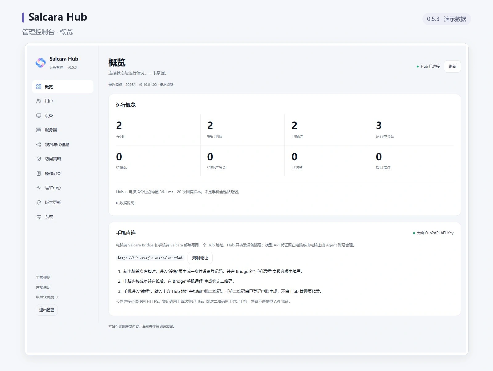
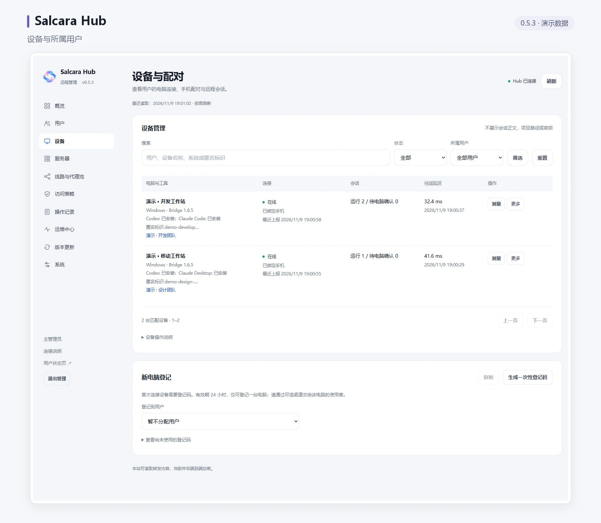
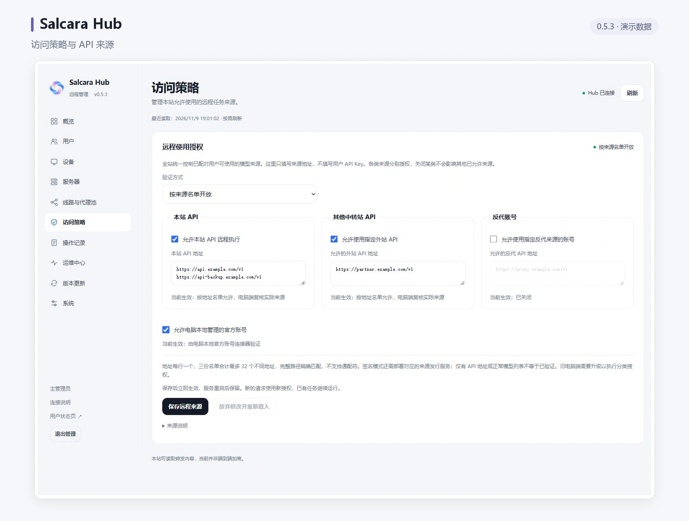

# Salcara Hub

让手机与电脑上的 AI 工作台连接起来。

Salcara Hub 是可自托管的远程编程连接服务，适合个人团队和中转站运营者。它负责设备配对、消息转发和连接管理，需要与 Salcara 手机 App、[桌面 App](https://github.com/dkdjndbfj-wq/salcara-desktop) 配套使用。

手机 App ⇄ Salcara Hub ⇄ 桌面 App ⇄ 电脑上的 Agent

Hub 不运行大模型，也不要求用户提交中转站账号或模型 API Key。任务由电脑端执行；管理人员可以在独立网页控制台管理连接和设备。

## 界面预览

以下截图来自已发布的 Hub 0.5.3 管理控制台，使用演示用户、设备与来源地址。

**连接概览** · 当前界面 · 演示数据。集中查看电脑在线状态、设备配对与会话概况。



**用户与设备** · 当前界面 · 演示数据。按用户管理已登记的电脑，查看连接状态与配对情况。



**来源访问策略** · 当前界面 · 演示数据。按来源类别和完整 API 地址设置远程使用范围。



## 主要功能

- 手机扫码绑定电脑，绑定后即可使用，无需逐个审批。
- 查看设备连接状态，测量 Hub 与电脑的往返延迟，撤销绑定、断开或封禁设备。
- 提供省资源、均衡、高负载三种运行模式，适配不同服务器条件。
- 单个 Docker 容器部署，提供可视化管理控制台。
- 初始管理员密码自动生成，可在控制台更改账号和密码；遗失后可在服务器恢复，保留设备数据。
- 支持签名验证的 Hub 程序更新，与现有中转服务分别维护。
- 0.5.3 新增运维中心：分角色协作、可查询导出的操作审计、健康与监控接口、离线加密备份和校验恢复，见 [运维与恢复](docs/OPERATIONS-AND-RECOVERY.zh.md)。
- 0.5.3 支持全站分别开关本站 API、外站 API、反代账号和官方账号，按完整来源地址限制远程执行，见 [远程使用授权](docs/REMOTE-SOURCE-AUTHORIZATION.zh.md)。
- 0.5.3 支持管理员账号登录、用户档案、按用户登记和关联电脑、禁用用户及单独来源授权，见 [用户与设备管理](docs/USER-MANAGEMENT.zh.md)。手机保持原扫码流程。
- 0.5.6 发布准备：保留任务原状态与回执，支持撤回尚未派发的待发任务，修复队列恢复和 Bot 设备清理，并显示安全记录容量；配套 Android 1.8.6（versionCode 27）/ Desktop（Bridge）1.6.9，见 [版本说明与待验收项](docs/RELEASE-0.5.6.md)。

远程会话、消息和 Agent 操作需要电脑在线，并以桌面端已安装、已授权的能力为准；仅部署 Hub 不会自动开放 Agent 未提供的原生桌面接口。

## 快速部署

准备一台 Linux 主机、Docker Engine / Compose、自己控制的域名和 HTTPS 反向代理。支持的镜像平台为 `linux/amd64` 和 `linux/arm64`。

以下安装示例以 0.5.6 为目标。执行前在 [Releases](https://github.com/dkdjndbfj-wq/salcara-hub-plugin/releases) 确认 `standalone-v0.5.6` 已正式发布且同版本镜像可拉取；源码或文档更新不代表发布完成。在本地审阅该版本脚本后执行：

```sh
git clone --branch standalone-v0.5.6 --depth 1 https://github.com/dkdjndbfj-wq/salcara-hub-plugin.git salcara-hub
cd salcara-hub
bash deploy/standalone/install.sh \
  --public-url https://relay.example.com/salcara-hub \
  --install-dir /opt/salcara-hub
```

把示例域名换成自己的域名。安装脚本会创建独立 Hub 服务，给出管理地址、密钥文件位置及反代配置片段；它不会安装 Docker、修改现有反代或停止其他服务。已有 Hub 数据的用户请走升级步骤，不要重新初始化。

完整的反代配置、手动安装、迁移和验收步骤见 [部署教程](docs/STANDALONE-DOCKER.zh.md)。也可以把 [Agent 部署指南](docs/AGENT-DEPLOY.zh.md) 交给你的编程 Agent，完成后让它提供实际 URL 和待验收项。

协议升级时的最低桌面版本设置与旧客户端迁移顺序见 [桌面版本兼容性](docs/DESKTOP-COMPATIBILITY.zh.md)。

## 开始使用

1. 完成 HTTPS 反代配置，打开 `https://你的域名/salcara-hub/admin/`。
2. 在自己的安全终端或编辑器中读取安装输出指定的初始管理密钥文件，以账号 `admin`、整行密钥作为密码登录。历史 0.5.2 页面只填密钥；升级后首次使用 `admin` 和原管理密钥。设置过账号和密码后使用新值。不要把密钥放进 URL 或发给别人。
3. 在配套 Salcara 桌面 App 中选择已有 API 并检查连接；站点已配置可信登记服务并明确授权时，可自动登记电脑。不支持自动登记的独立 Hub，由管理员先创建用户、生成一次性电脑登记码，再通过可信渠道交给电脑使用者。登记成功后生成配对二维码。
4. 用 Salcara 手机 App 扫码绑定，选择电脑和 Agent，加载会话或发起任务。

模型 API 由桌面 App 配置，不需要填进 Hub 后台。普通用户绑定电脑也不需要管理员密钥。

如需嵌入现有中转站的侧边栏，添加所需的同源自定义 iframe 页面：

| 页面 | URL 路径 | 可见范围 |
| --- | --- | --- |
| 管理控制台 | `/salcara-hub/admin/` | 管理员 |
| 连接说明 | `/salcara-hub/` | 普通用户 |
| 用户状态页 | `/salcara-hub/status` | 公开，无需管理员登录 |

将路径拼在你自己的 HTTPS 站点地址后。管理页面仍需独立登录；菜单可见范围不能代替权限验证。

## 更新与维护

0.5.3 新增独立的「版本更新」页面。使用包含新版启动器的 Docker 镜像后，服务启动时自动检查新版本，默认每 6 小时再检查一次；左上角显示当前版本，发现签名新版后版本号变色，点击即可确认更新，也可在更新页面点击「一键更新」。页面显示当前版本、最新版本、最近检查和下次检查时间，也可随时手动检查。

一键更新安装签名验证后的 Hub 程序，保留管理密钥、设备绑定和持久数据，重启后需要重新登录。Docker 基础镜像和启动器通过 Compose 升级；已有安装首次启用后台定时检查，需要切换到包含新启动器的已发布镜像。仓库代码不代表正式镜像已经发布，发布也不会自动重启已部署的 Hub。所有升级、恢复和卸载都应先备份，保留原项目与完整数据卷；不要用旧备份恢复已撤销的权限。检测周期与部署步骤见 [更新与资源](docs/STANDALONE-DOCKER.zh.md#更新与资源)。

- [部署、升级、恢复密钥与卸载](docs/STANDALONE-DOCKER.zh.md)
- [交给 Agent 部署](docs/AGENT-DEPLOY.zh.md)
- [正式版本下载与说明](https://github.com/dkdjndbfj-wq/salcara-hub-plugin/releases)
- [发布维护说明](docs/STANDALONE-RELEASE.zh.md)

## 安全与资源

默认只向宿主机回环地址发布端口，由 HTTPS 反代对外提供服务；不挂载 Docker socket。默认容器内存上限为 384 MiB，这是资源配额，不是实际占用或承载用户数保证。

聊天历史主要保存在电脑端；Hub 的有限暂存不是永久云端备份。当前不是端到端加密，服务运行方能够读取转发内容。请使用你信任的服务地址，并保护管理员密钥、设备凭据及数据备份。

本项目开放源码，许可证及第三方归属见 [LICENSE](LICENSE) 和 [THIRD_PARTY_NOTICES.md](THIRD_PARTY_NOTICES.md)。
